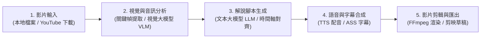

# 📽️ NarratoAI 完整操作手冊（繁體中文版）

本手冊整理了 **NarratoAI** 的整體運作流程、Docker 與本地啟動方式、AI 模型最佳化配置、YouTube (`yt-dlp`) 影片下載、繁體中文文案設定，以及本地部署 **IndexTTS-2** 語音克隆的串接指南

docker compose up -d
docker compose up -d --build
docker compose restart
http://localhost:8501
---

## 目錄

1. [整體系統架構與工作流程](#1-整體系統架構與工作流程)
2. [啟動服務與查看訪問地址](#2-啟動服務與查看訪問地址)
3. [AI 模型配置與 Token 成本最佳化建議](#3-ai-模型配置與-token-成本最佳化建議)
4. [影片來源：本地上傳與 YouTube (yt-dlp) 自動下載](#4-影片來源本地上傳與-youtube-yt-dlp-自動下載)
5. [設定繁體中文文案輸出](#5-設定繁體中文文案輸出)
6. [語音合成 (TTS) 與本地 IndexTTS-2 串接教學](#6-語音合成-tts-與本地-indextts-2-串接教學)
7. [畫面、字幕與剪映草稿匯出](#7-畫面字幕與剪映草稿匯出)
8. [常見問題排解 (FAQ)](#8-常見問題排解-faq)

---

## 1. 整體系統架構與工作流程

NarratoAI 的自動化影視解說生成分為 **4 大階段**：



| 階段 | 對應模組 | 負責工作 | 使用的 AI 模型類型 |
| :--- | :--- | :--- | :--- |
| **階段一：影片獲取** | `app/services/youtube_service.py` | 支援本地上傳，或透過內建 `yt-dlp` 直接輸入網址下載影片 | 無（使用 `yt-dlp` + `FFmpeg`） |
| **階段二：視覺畫面理解** | `app/services/SDP/`、`app/services/SDE/` | 依間隔抽取影片關鍵幀（Batch 批次打包），分析畫面劇情、人物與場景 | **多模態視覺模型 (VLM)**<br>如 `gemini-2.0-flash`、`qwen2.5-vl` |
| **階段三：解說文案生成** | `app/services/llm/` | 結合視覺分析結果與原片字幕，撰寫符合指定風格與語言的分鏡解說詞 | **文本生成模型 (LLM)**<br>如 `deepseek-chat`、`gpt-4o-mini`、`gemini-2.0-flash` |
| **階段四：配音與成片渲染** | `app/services/voice.py`、`video.py` | 合成旁白語音（Edge-TTS / IndexTTS-2 等）、產生時間軸字幕並透過 FFmpeg 合成最終影片 | **語音合成模型 (TTS)**<br>如 `IndexTTS-2`、`Edge-TTS`、`Qwen-TTS` |

---

## 2. 啟動服務與查看訪問地址

### 方式 A：使用一鍵啟動腳本（推薦，自動顯示訪問網址）

在專案根目錄下直接執行：

```bash
./start.sh
```

啟動完成後，終端機會自動顯示所有可用的訪問地址：

```text
============================================================
  🚀 NarratoAI 已成功啟動！

  🌐 請在瀏覽器打開以下地址：
     👉 本地訪問地址: http://localhost:8501
     👉 備用本地地址: http://127.0.0.1:8501
     👉 局域網訪問:   http://192.168.x.x:8501
============================================================
```

- **強制使用 Docker 啟動**：`./start.sh docker`
- **強制使用本地 Python/uv 啟動**：`./start.sh local`

### 方式 B：使用 Make 指令啟動

```bash
make up        # 啟動 Docker 容器並顯示訪問地址
make restart   # 重啟服務並顯示訪問地址
make logs      # 查看容器即時日誌（包含啟動網址橫幅）
make down      # 停止服務
```

### 方式 C：原生 Docker Compose 指令

```bash
# 建置映像檔（首次或更新程式碼後執行）
docker compose build

# 背景啟動容器
docker compose up -d
```

> [!WARNING]
> 在 macOS 瀏覽器（Safari / Chrome）中，請務必輸入 **`http://localhost:8501`** 或 **`http://127.0.0.1:8501`**，請勿輸入 `http://0.0.0.0:8501`。

---

## 3. AI 模型配置與 Token 成本最佳化建議

在 WebUI 的 **「基礎設置 (Basic Settings)」** 中，系統將 AI 模型拆分為 **視覺分析模型** 與 **文案生成模型**，分開配置可大幅節省 Token 費用：

### 3.1 視覺分析模型（Vision Model）推薦
視覺模型需要處理大量圖片幀，Token 消耗量最大，建議選擇具備高壓縮比與低單價的模型：
1. **首選：`gemini-2.0-flash`（Google Gemini）**
   - 每張圖片僅消耗約 258 Tokens，速度極快、支援超大 Context Window，且性價比最高。
2. **次選：`qwen2.5-vl-72b-instruct` 或 `qwen-vl-max`（阿里雲通義千問）**
   - 中文影視場景與人物情緒識別準確度高。

**省 Token 參數建議（於 `config.toml` 的 `[frames]` 區塊）**：
- `frame_interval_input = 3`（每 3 秒抽一幀，避免抽幀過密浪費 Token）
- `vision_batch_size = 10`（每次請求批次送出 10 張圖，減少重複 Prompt 開銷）

### 3.2 文案生成模型（Text Generation LLM）推薦
文案模型負責撰寫旁白與劇情結構，重邏輯與文筆：
1. **首選：`deepseek-chat` (DeepSeek-V3)**
   - 中文敘事流暢度極佳、有網感，支援 Context Caching（快取命中時輸入成本極低）。
2. **次選：`gemini-2.0-flash` 或 `gpt-4o-mini`**
   - 結構化 JSON 輸出穩定，極少發生格式解析錯誤。

---

## 4. 影片來源：本地上傳與 YouTube (yt-dlp) 自動下載

在 **「文案設置 (Script Settings)」** 的 **「選擇視頻來源」** 中共有三種模式：

1. **上傳本地視頻**：直接從電腦選取 `.mp4`、`.mov`、`.mkv`、`.avi` 等檔案。
2. **選擇資源目錄視頻**：讀取專案下 `resource/videos/` 資料夾內的影片。
3. **YouTube / 網址下載 (yt-dlp)**：
   - 支援輸入 YouTube、Bilibili 等 `yt-dlp` 支援的影片網址。
   - 選擇最高畫質（`best`、`1080p`、`720p`、`480p`）。
   - 點擊 **「下載視頻」**，系統會自動下載並合併為 `.mp4`，同時自動掛載為當前工作影片。

**下載影片的儲存位置**：
- **您的 Mac 本機路徑**：`NarratoAI/resource/videos/`
- **Docker 容器內路徑**：`/NarratoAI/resource/videos/`（已透過 Volume 即時雙向同步）

---

## 5. 設定繁體中文文案輸出

若希望 AI 產生的解說腳本與字幕全部為 **繁體中文**：

1. 展開 **「基礎設置 (Basic Settings)」**。
2. 找到 **「輸出語言 (Output Language)」** 下拉選單。
3. 選擇 **`繁體中文 (台灣) (zh-TW)`** 或 **`繁體中文 (香港) (zh-HK)`**。
4. AI 在生成解說詞、分鏡腳本及 SRT/ASS 字幕時，即會嚴格以繁體中文輸出。

---

## 6. 語音合成 (TTS)：ElevenLabs 台灣/中英文配音 & 本地 IndexTTS-2 教學

### 6.1 ElevenLabs 多語系配音（內建台灣口音 Anna Su 預設與中英熱門音色）

1. **獲取 ElevenLabs API Key (`xi-api-key`)**：
   - 前往 [ElevenLabs API Keys 管理頁](https://elevenlabs.io/app/settings/api-keys) 登入並點擊 **Create API Key**。
   - 若開啟權限控管（Restricted Key），請確保勾選 **`Text to Speech`** 與 **`Voices (Read / Write)`**。
2. **在 WebUI 或 `config.toml` 配置**：
   - 在 WebUI **「音頻設置 (Audio Settings)」** 中，將 **TTS 引擎** 選擇為 **`ElevenLabs 多語系配音 (台灣/中英)`**。
   - 貼上您的 `ElevenLabs API Key`（亦可在 `config.toml` 的 `[elevenlabs]` 區塊填寫 `api_key = "sk_..."`）。
3. **內建熱門音色（預設為台灣口音 Anna Su）**：
   - **🇹🇼 台灣口音推薦**：
     - `Anna Su (安娜蘇 - 甜美自然)`：`9lHjugDhwqoxA5MhX0az` **（系統預設）**
     - `Anna Su (專業解說版 - 清晰知性)`：`r6qgCCGI7RWKXCagm158`
     - `小雅 (Xiaoya - 台灣溫柔女聲)`：`fQj4gJSexpu8RDE2Ii5m`
   - **🇨🇳 華語/普通話熱門**：
     - `ShanShan (珊珊)`：`ByhETIclHirOlWnWKhHc`、`Amy (艾米)`：`bhJUNIXWQQ94l8eI2VUf`
     - `Evan Zhao (趙先生)`：`MI36FIkp9wRP7cpWKPTl`、`Jason Chen (陳先生)`：`DowyQ68vDpgFYdWVGjc3`、`Haoran (浩然)`：`pU9NaAwkoR3v0Mrg3uKz`、`Siqi Liu (劉思齊)`：`W8lBaQb9YIoddhxfQNLP`
   - **🇺🇸/🇬🇧 英文熱門（配合 `eleven_multilingual_v2` 亦支援中英混讀）**：
     - 女聲：`Rachel` (`21m00Tcm4TlvDq8ikWAM`)、`Sarah` (`EXAVITQu4vr4xnSDxMaL`)、`Jessica` (`cgSgspJ2msm6clMCkdW9`)、`Lily` (`pFZP5JQG7iQjIQuC4Bku`)
     - 男聲：`Brian` (`nPczCjzI2devNBz1zQrb`)、`Adam` (`pNInz6obpgDQGcFmaJgB`)、`George` (`JBFqnCBsd6RMkjVDRZzb`)、`Josh` (`TxGEqnHWrfWFTfGW9XjX`)、`Chris` (`iP95p4xoKVk53GoZ742B`)
   - **同步帳號音色 & 自訂 Voice ID**：點擊 **「同步音色」** 按鈕可直接拉取您 ElevenLabs 帳號內收藏的所有音色，或直接在「自訂 Voice ID」欄位貼上任意音色 ID。

---

### 6.2 本地部署 IndexTTS-2 架構說明：為什麼不在 Docker 容器內？
- 在 Apple Silicon Mac（M1/M2/M3/M4）上，**IndexTTS-2** 使用 Apple 原生 **MLX 框架** 進行 Metal GPU 硬體加速。
- Docker 在 macOS 上運行於 Linux 虛擬機內，無法直接呼叫 macOS 原生 MLX 加速。
- 因此，**IndexTTS-2 作為獨立服務運行在您的 Mac 本機上**，而 Docker 內的 NarratoAI 透過網路 API 呼叫它。

### 6.3 設定步驟（Mac Docker 版 NarratoAI + Mac 本機 IndexTTS-2）

1. **在 Mac 本機啟動 IndexTTS-2 MLX Pack**：
   - 執行整合包內的 `start.command`，確認服務已在 Mac 本機 `7860` 埠啟動。
2. **在 NarratoAI WebUI 選擇引擎**：
   - 在 **「音頻設置 (Audio Settings)」** 中，將 TTS 引擎選為 **`IndexTTS-2`**。
3. **填寫 API 服務地址（關鍵！）**：
   - **若 NarratoAI 運行在 Docker 中**，請填寫：
     ```text
     http://host.docker.internal:7860
     ```
     *(注意：Docker 容器內不能填 `127.0.0.1:7860`，必須用 `host.docker.internal` 才能連回 Mac 宿主機)*
   - **若 NarratoAI 直接在 Mac 本機用 `uv` 運行**，則保持預設：
     ```text
     http://127.0.0.1:7860
     ```
4. **上傳參考音頻與調整情感**：
   - 上傳一段 3～10 秒清晰無背景音樂的人聲 `.wav` 或 `.mp3`。
   - 可留空保留原音色情緒，或在情感欄位輸入如 `happy:0.7,calm:0.3` 進行情緒混合控制。

---

## 7. 畫面、字幕與剪映草稿匯出

1. **視頻設置 (Video Settings)**：
   - 可選擇畫面比例（橫屏 `16:9`、豎屏 `9:16`），並設定子母畫面或安全區域裁切。
2. **字幕設置 (Subtitle Settings)**：
   - 可自訂字型（存放於 `resource/fonts/`）、字體大小、顏色、描邊與位置。
3. **兩種輸出方式**：
   - **直接生成成片**：點擊 **「生成視頻 (Generate Video)」**，完成後成片會儲存於 `storage/tasks/<任務ID>/`。
   - **匯出至剪映草稿**：在基礎設置設定好「剪映草稿資料夾路徑」後，點擊 **「導出到剪映草稿」**，即可在剪映專業版 (JianyingPro) 中自由微調時間軸、音效與特效。

---

## 8. 常見問題排解 (FAQ)

### Q1：`docker compose up -d` 啟動時報錯 `mount config.toml: not a directory`？
- **原因**：啟動容器前若本地沒有 `config.toml` 檔案，Docker 會誤將它建立為「空資料夾」，導致掛載失敗。
- **解法**：使用 `./start.sh` 啟動（腳本會自動清理異常資料夾並從 `config.example.toml` 複製生成正確檔案），或手動執行：
  ```bash
  rm -rf config.toml && cp config.example.toml config.toml
  docker compose up -d
  ```

### Q2：在 Docker 中點擊 YouTube 下載提示找不到 `yt-dlp`？
- **原因**：使用了舊版尚未重新 build 的 Docker 映像檔。
- **解法**：重新建置映像檔並啟動：
  ```bash
  docker compose build
  docker compose up -d
  ```

### Q3：忘記目前的訪問網址或想在區網內其他設備（如 iPad）打開？
- 在專案目錄下執行 `./start.sh` 或 `docker compose logs --tail=30`，即可在終端機看到完整的本地地址（`http://localhost:8501`）與區網 IP 地址（`http://192.168.x.x:8501`）。

